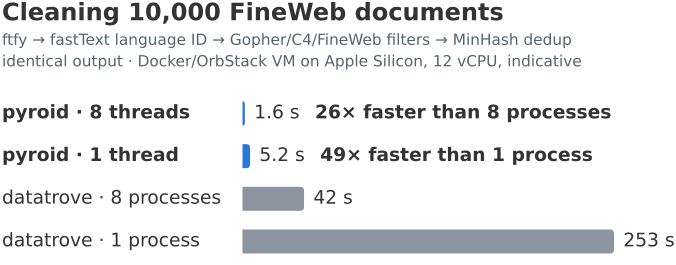

# pyroid

[](https://pypi.org/project/pyroid/)
[](https://pypi.org/project/pyroid/)
[](https://github.com/ao/pyroid/blob/main/LICENSE)
[](https://github.com/ao/pyroid/actions/workflows/ci.yml)

[Docs](https://ao.github.io/pyroid/) | [Benchmarks](https://ao.github.io/pyroid/benchmarks/) | [Compatibility](https://ao.github.io/pyroid/compatibility/)

**Drop-in Rust replacements for the Python tools that clean LLM datasets (ftfy, fastText
inference, datatrove's filters and dedup) and score model output (rouge-score, sacrebleu,
json_repair): the same API, the same output, a fraction of the CPU time.**

> [!NOTE]
> pyroid 1.0 is not on PyPI yet: until it is, `pip install pyroid` gives the unrelated 0.7.x
> toolkit ([see below](#the-07x-releases)). Speed numbers are from a Docker VM (indicative); a
> bare-metal run is pending.

Two ways in that change none of your code:

```console
$ pip install "pyroid[cli]"
$ pyroid clean in.parquet out.parquet --recipe fineweb   # datatrove's FineWeb pipeline, same output
```

```python
import pyroid

pyroid.patch("ftfy", "fasttext")  # code that imports ftfy or fasttext from here on gets pyroid's
```

<!-- TODO(bare-metal): replace with the bare-metal run's hero (bench/consolidate.py writes it to
     charts/hero-{light,dark}.svg; copy it to docs/assets/) and update the alt text and caption. -->
<picture>
  <source media="(prefers-color-scheme: dark)" srcset="https://raw.githubusercontent.com/ao/pyroid/main/docs/assets/hero-dark.svg">
  
</picture>

<sub>Wall time of the FineWeb chain (ftfy → language ID → 4 quality filters → MinHash dedup) on the
first 10,000 documents of the pinned FineWeb slice, with 1 and 8 processes or threads on 8 of 12
vCPUs. datatrove 0.10.1 (ftfy 6.3.1, fasttext-predict 0.9.2.4, spaCy 3.8.18) on CPython 3.13.18;
pyroid 1.0.0.dev0's native chain on free-threaded CPython 3.15.2. The same output document for
document. Docker VM, indicative.</sub>

Or install it and import the modules directly:

```console
$ pip install pyroid               # add [fasttext] for pyroid.fasttext (numpy)
```

```python
import pyroid.ftfy as ftfy  # was: import ftfy (byte-identical output)
import pyroid.fasttext as fasttext  # was: import fasttext (same .bin/.ftz models); needs [fasttext]
import pyroid.filters as filters  # datatrove's Gopher/C4/FineWeb filters (same decisions)
from pyroid.metrics import rouge_scorer  # was: from rouge_score import rouge_scorer
import pyroid.json_repair as json_repair  # was: import json_repair

docs = ftfy.fix_text_batch(docs)  # all cores, GIL released
lid = fasttext.load_model("lid.176.bin")
labels, probs = lid.predict([d.replace("\n", " ") for d in docs], k=1)
fineweb_filters = [
    filters.GopherRepetition(),
    filters.GopherQuality(),
    filters.C4Quality(filter_no_terminal_punct=False),
    filters.FineWebQuality(),
]
result = filters.apply(docs, fineweb_filters)  # in datatrove's order, one tokenization per doc
clean = [text for text, keep in zip(result.text, result.keep) if keep]
```

Batch functions take a `str`, a `list` of `str` or an Arrow column (pyarrow, polars, Hugging Face
`datasets`); text and masks come back in the same kind.

**Replaces:** ftfy · fastText inference (fasttext, fasttext-wheel, fasttext-predict) · datatrove's
Gopher, C4, FineWeb, PII, bad-words, symbol-lines and URL steps, MinHash and sentence dedup, in
3,999 of its 4,343 languages · rouge-score · sacrebleu's BLEU and chrF · json_repair · Unidecode
(permissive, anyascii-based)

## Why

- **Faster, measured against the incumbents** (Docker/OrbStack VM on Apple Silicon (12 vCPU),
  indicative: [methodology](https://ao.github.io/pyroid/benchmarks/)): the whole FineWeb chain
  on 8 threads is **26× faster than datatrove on 8 processes**, and **49× faster
  single-threaded**, with identical output (10,000 FineWeb documents: 1.61 s against 41.93 s, and
  5.16 s against 253.20 s). Per stage, on one thread: `fix_text_batch` 147× faster than ftfy;
  datatrove's quality filters 52–107× and MinHash signatures 63× faster than datatrove (36–86× on
  German, French, Spanish, Russian and Arabic); fastText language ID 2.1× (`.bin`) and 4.3×
  (`.ftz`) faster; transliteration 79× faster than anyascii; ROUGE 59–65× faster than
  rouge-score, corpus BLEU 11× and chrF 19× faster than sacrebleu; json_repair about 30× faster
  on broken JSON, and linear where json_repair is quadratic. Swapping pyroid's steps into
  datatrove's own pipeline made it 21–24× faster.
- **Same output, checked:** byte-identical to ftfy 6.3.1, bit-identical fastText labels and
  probabilities, datatrove's keep/drop decisions, reasons and dedup files, rouge-score's and
  sacrebleu's scores to the last digit, and json_repair's repairs, on pinned real data and
  property-based fuzzing ([parity counts](https://ao.github.io/pyroid/compatibility/)). Verified
  on Linux aarch64, and on x86_64 under emulation; the other platforms are checked in CI before
  release.
- **Installs everywhere:** wheels for CPython 3.11–3.15 and free-threaded 3.14t/3.15t, on Linux
  (glibc and musl), macOS and Windows, x86-64 and ARM64. No compiler, no runtime dependencies.
- **Threads, not processes:** batch calls release the GIL and run on all cores, and one loaded
  fastText model serves every thread (one copy in memory instead of one per worker process).
- **Never silently different:** where a module meets an option or input it doesn't port, it hands
  the call to the real library with a `pyroid.FallbackWarning`, or raises.

| Module | Replaces |
|---|---|
| [`pyroid.ftfy`](https://ao.github.io/pyroid/guides/ftfy/) | ftfy 6.3.1 |
| [`pyroid.fasttext`](https://ao.github.io/pyroid/guides/fasttext/) | fastText inference |
| [`pyroid.filters`](https://ao.github.io/pyroid/guides/filters/) | datatrove 0.10.1's Gopher, C4, FineWeb, PII, C4 bad-words, symbol-lines and URL filters |
| [`pyroid.dedup`](https://ao.github.io/pyroid/guides/dedup/) | datatrove 0.10.1's MinHash and sentence dedup |
| [`pyroid.translit`](https://ao.github.io/pyroid/guides/translit/) | anyascii; a permissive alternative to Unidecode |
| [`pyroid.metrics`](https://ao.github.io/pyroid/guides/metrics/) | rouge-score 0.1.2; sacrebleu 2.6.0's BLEU, chrF and chrF++ |
| [`pyroid.json_repair`](https://ao.github.io/pyroid/guides/json_repair/) | json_repair 0.64.5 |
| [`pyroid clean`](https://ao.github.io/pyroid/guides/cli/), [`pyroid.patch()`](https://ao.github.io/pyroid/guides/patch/), [datatrove steps](https://ao.github.io/pyroid/guides/datatrove/), [HF `datasets`](https://ao.github.io/pyroid/guides/huggingface/) | integrations: a CLI, import shims for code you don't own, drop-in datatrove pipeline steps, `Dataset.map`/`filter` helpers |

## The 0.7.x releases

pyroid 1.0 is a rewrite. The previous general-purpose toolkit (0.1–0.7) is **not** carried
forward, and the 1.0 API is incompatible with it.

- 0.7.x stays installable from PyPI: `pip install "pyroid<1"`.
- Its source is kept on the [`legacy`](https://github.com/ao/pyroid/tree/legacy) branch.
- [Migrating from 0.7](https://ao.github.io/pyroid/migrating-from-0.7/) lists replacements.

## Development

The extension is built with [maturin](https://www.maturin.rs/):

```console
$ uv venv && source .venv/bin/activate
$ uv pip install maturin --group test
$ maturin develop --uv     # builds pyroid._pyroid into the venv (editable)
$ pytest python/tests
$ cargo test               # pure-Rust core (crates/pyroid-core)
```

Layout: `crates/pyroid-core` (pure Rust, no Python), `crates/pyroid-py` (PyO3 bindings, built as
`pyroid._pyroid`), `python/pyroid` (the typed Python package), `bench/` (benchmark harness),
`parity/` (differential tests against the incumbents) and `docs/` (this documentation). See
[CONTRIBUTING.md](CONTRIBUTING.md).

## License

pyroid's own code is MIT. The ported parts keep their licences, so the package's licence
expression is `MIT AND Apache-2.0 AND BSD-3-Clause AND ISC AND PSF-2.0 AND Unicode-3.0`:

- Apache-2.0: ported from ftfy, datatrove, rouge-score, NLTK's Porter stemmer and sacrebleu;
- MIT: ported from spaCy, indic-nlp-library, urduhack and json_repair;
- BSD-3-Clause: numpy's random generator (for C4 bad words) and tldextract;
- PSF-2.0: CPython's `ipaddress` (IPv6 parsing);
- ISC: anyascii's transliteration data;
- Unicode-3.0: data from the Unicode Character Database.

See [LICENSE](LICENSE), [LICENSES/](LICENSES) and [NOTICE](NOTICE), which lists the ported files.
