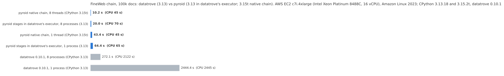
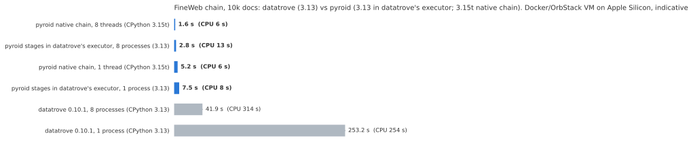
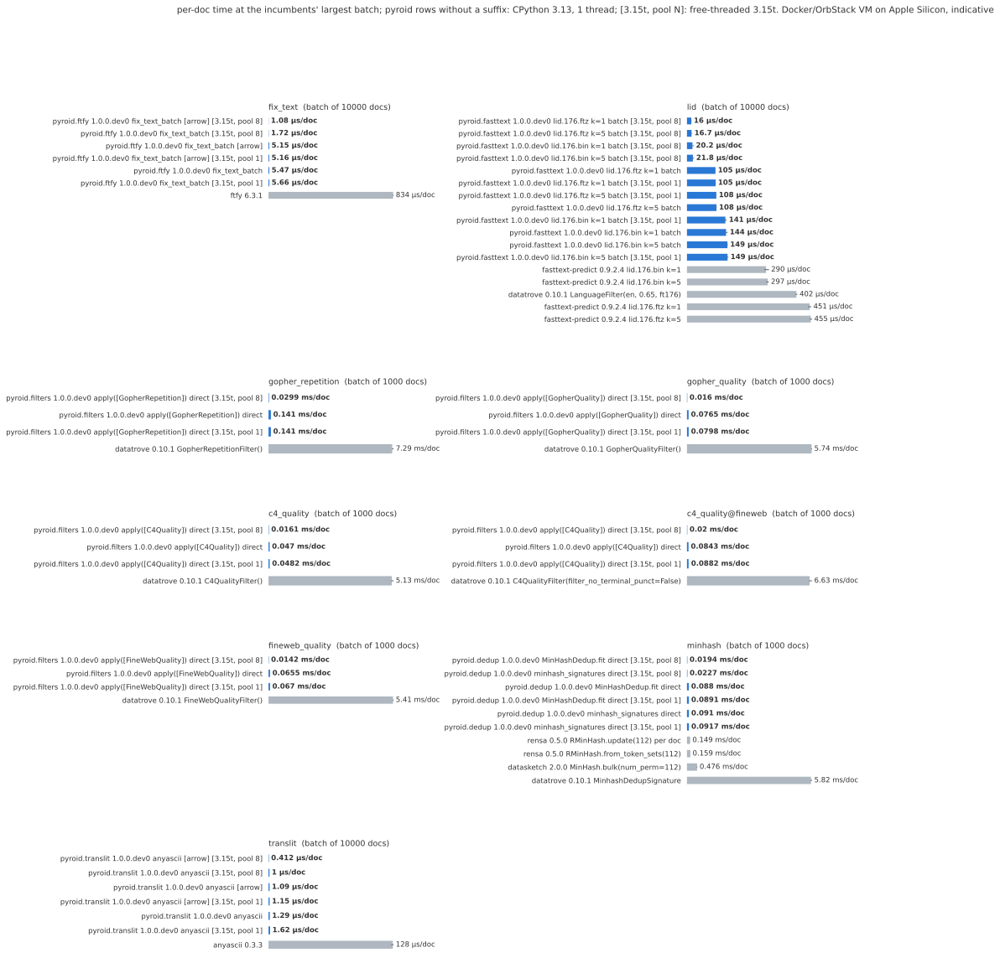

# Benchmarks

Most numbers on this page come from two AWS EC2 instances, measured on 2026-11-06 at commit
`f35bd9e4`: a c7i.4xlarge (Intel Xeon Platinum 8488C, Sapphire Rapids) and a c8g.4xlarge (AWS
Graviton4). Both have 16 vCPUs and run Amazon Linux 2023. They are VMs on real hardware, not bare
metal. Every timed run was pinned to 8 CPUs; on the c7i that is one thread per core. The runs
[from WARC files](#from-warc-files-datatroves-fineweb-pipeline) are from two other c7i.4xlarge
instances, on 2026-11-09 and 2026-11-10.

datatrove 0.10.1 and the other incumbents ran on CPython 3.13.18, and pyroid on free-threaded
CPython 3.15.2t, from release wheels built on each machine (the WARC run used CPython 3.13.18 for
both). The section on [other modules](#other-modules-languages-and-integrations) and the
[earlier runs](#earlier-runs) are from a Docker VM on a Mac and are labelled as such.

## Summary

From raw Common Crawl WARC files to deduplicated documents, datatrove's FineWeb pipeline ran 9.5×
faster with pyroid's steps in datatrove's own executor, pyroid's `WarcReader` included: 89.4 s
against 848.3 s for stock datatrove with 8 workers. As one command,
`pyroid clean --recipe fineweb-warc` took 79.6 s (10.7×). That is 8 WARC files of CC-MAIN-2026-39
(171,595 HTML records) on the c7i.4xlarge. With datatrove's reader, the first run had given 8.4× at
8 workers and 9.0× at one. Text extraction is most of the difference. Both kept the same
documents, once the pages stock datatrove drops at its 1 s extraction timeout are left out of
pyroid's run too.

On 100,000 FineWeb documents on the c7i.4xlarge, pyroid's FineWeb chain took 10.2 s with 8
threads, against 272.1 s for datatrove with 8 processes: about 27× faster. On one thread it took
43.4 s against 2,444.4 s, about 56× faster. The output is the same document for document. On the
c8g.4xlarge the same comparison gives 29× and 50×.

On the 10,000-document dev slice the ratios are 18× (8 threads against 8 processes) and 38× (one
thread against one process) on the c7i, and 20× and 45× on the c8g.

Stage by stage, on one thread against one process on the c7i, pyroid is 1.6× (fastText with
`lid.176.bin`) to 108× (ftfy) faster than the library it replaces. The quality filters are 35–69×
faster and MinHash signatures 34×.

The 100k datatrove runs and the runs of pyroid's stages in datatrove's executor were timed once
each, without a warm-up, because a single-process datatrove run takes about 40 minutes. The other
rows are medians of several runs.

## From WARC files: datatrove's FineWeb pipeline

[`bench/fineweb_warc.py`](https://github.com/ao/pyroid/blob/main/bench/fineweb_warc.py) runs
datatrove 0.10.1's `examples/fineweb.py` from WARC files to the final documents: `WarcReader`,
`URLFilter`, `Trafilatura(favour_precision=True)`, `LanguageFilter` (English), the Gopher, C4 and
FineWeb quality filters with their exclusion writers, MinHash dedup in its four stages, and
`PIIFormatter`. It ran three ways, each with 8 workers and with 1:

- stock datatrove, as a fresh `pip install 'datatrove[io,processing]==0.10.1'` resolves it
  (trafilatura 1.11.0), in datatrove's `LocalPipelineExecutor`;
- the same pipeline and executor with pyroid's [drop-in steps](guides/datatrove.md) for
  `Trafilatura` (which follows the installed trafilatura 1.11.0), `URLFilter`,
  `LanguageFilter`, the four quality filters, the MinHash signatures and `PIIFormatter`; the
  reader, the writers and the other three MinHash stages stay datatrove's;
- a native pyroid chain without the executor: per WARC file, in a pool of processes,
  `pyroid.trafilatura.extract_batch(compat="1.11.0")`, language ID and the filters; then MinHash
  dedup and PII over all files in one process.

Every mode runs one task per WARC file, so its output does not depend on the number of workers.

<!-- bench:table:c7i-warc:begin -->
<!-- Generated by docs/scripts/render_benchmarks.py from docs/data/benchmarks.json. -->

AWS EC2 c7i.4xlarge (Intel Xeon Platinum 8488C, 16 vCPU), Amazon Linux 2023, every run on CPUs 0 to 7; CPython 3.13.18, datatrove 0.10.1 with trafilatura 1.11.0, and a pyroid release wheel built on the instance. 8 WARC files of CC-MAIN-2026-39 (7.5 GB, 171,595 HTML records), one task per file. Each run was timed once; fastest first. CPU s is user+sys including the worker processes. The Trafilatura column is the time datatrove's statistics give that step, summed over tasks.

| Run | Wall s | vs stock datatrove, same workers | CPU s | Trafilatura step, s | Pages dropped at the 1 s timeout | Documents kept | Peak RSS of the largest process, MiB |
|---|---:|---:|---:|---:|---:|---:|---:|
| datatrove with pyroid's steps, 8 workers | 104.0 | 8.4× | 792 | 514 | 0 | 23,505 | 1,206 |
| native pyroid chain, 8 workers | 110.3 | 7.9× | 808 | 526 | 0 | 23,505 | 874 |
| native pyroid chain, 1 worker | 738.7 | 9.4× | 740 | 487 | 0 | 23,505 | 885 |
| datatrove with pyroid's steps, 1 worker | 775.9 | 9.0× | 777 | 506 | 0 | 23,505 | 1,229 |
| stock datatrove, 8 workers | 870.8 | 1.0× | 6,759 | 5,543 | 69 | 23,503 | 965 |
| stock datatrove, 1 worker | 6,975.8 | 1.0× | 6,928 | 5,720 | 80 | 23,501 | 982 |

In every run, 5 more pages are lost because trafilatura 1.11.0 itself raises on them: datatrove's child process dies, and pyroid's step counts them as `broken_process` and drops them the same way.

<small>Source: bench/fineweb_warc.py and bench/ec2/run_warc.sh, run on 2026-11-09 (bench/results/aws-c7i.4xlarge/2026-11-09-warc: runs/*/summary.json and compare*.txt).</small>
<!-- bench:table:c7i-warc:end -->

Stock datatrove spends most of its time in Trafilatura: 5,543 of its 6,759 CPU seconds at 8
workers. With pyroid's steps that step takes 514 s.

Stock datatrove's results vary from run to run, and pyroid's do not. datatrove extracts each page
in a child process and gives up on it after 1 s (`timeout=1`), dropping the page and starting a new
child with an empty dedup cache. Which pages hit that limit depends on the load on the machine, so
the two stock runs dropped different pages (69 and 80) and kept different documents (23,503 and
23,501). pyroid's step extracts in the task's process and has no timeout, so it kept the same
23,505 documents in all four runs, with the same digest after MinHash and after PII.

To compare the documents exactly, the native chain was re-run with the pages each stock run
dropped left out the same way (`native --timeouts-of`). Its final documents then equal stock
datatrove's byte for byte, after MinHash and after PII, for both stock runs. Without that step,
pyroid's steps at 8 workers keep 2 documents more than stock datatrove at 8 workers, both from
pages stock datatrove timed out on, and no document's text differs.

Trafilatura is still the largest step with pyroid (514 of 792 CPU seconds at 8 workers). The next
was datatrove's `WarcReader`, which parses the WARC files with warcio in Python: 154 s.

### With pyroid's WARC reader

On 2026-11-10 the pipeline ran again over the same 8 files on another c7i.4xlarge, with pyroid's
`WarcReader` drop-in ([`pyroid.warc`](guides/warc.md)) among pyroid's steps, and as one command,
`pyroid clean --recipe fineweb-warc --workers 8` ([command line](guides/cli.md)). Stock datatrove
ran from the first run's exact package versions.

<!-- bench:table:c7i-warc-pyroid-reader:begin -->
<!-- Generated by docs/scripts/render_benchmarks.py from docs/data/benchmarks.json. -->

AWS EC2 c7i.4xlarge (Intel Xeon Platinum 8488C, 16 vCPU), Amazon Linux 2023, every run on CPUs 0 to 7; CPython 3.13.18, datatrove 0.10.1 with trafilatura 1.11.0 (the package versions of the 2026-11-09 run, installed from its freeze), and a pyroid release wheel built on the instance. The same 8 WARC files of CC-MAIN-2026-39 (7.5 GB, 171,595 HTML records), one task per file. Each run was timed once; fastest first. CPU s is user+sys including the worker processes. The step columns are the time datatrove's statistics, or the native chain's own timers, give each step, summed over tasks; the command line reports no per-step times.

| Run | Wall s | vs stock datatrove | CPU s | WARC reader step, s | Trafilatura step, s | Pages dropped at the 1 s timeout | Documents kept | Peak RSS of the largest process, MiB |
|---|---:|---:|---:|---:|---:|---:|---:|---:|
| `pyroid clean --recipe fineweb-warc`, 8 workers | 79.6 | 10.7× | 600 | – | – | 0 | 23,505 | 1,192 |
| datatrove with pyroid's steps, `WarcReader` included, 8 workers | 89.4 | 9.5× | 678 | 71 | 487 | 0 | 23,505 | 1,224 |
| native pyroid chain, 8 workers | 90.4 | 9.4× | 650 | 69 | 465 | 0 | 23,505 | 1,078 |
| stock datatrove, 8 workers | 848.3 | 1.0× | 6,593 | 170 | 5,403 | 68 | 23,503 | 966 |

In every run, 5 more pages are lost because trafilatura 1.11.0 itself raises on them, as in the 2026-11-09 run. At 1 worker, datatrove with pyroid's steps took 640.5 s and the native chain 607.8 s, with the same 23,505 documents; stock datatrove was not re-run at 1 worker.

<small>Source: bench/fineweb_warc.py and bench/ec2/run_warc.sh, run on 2026-11-10 (bench/results/aws-c7i.4xlarge/2026-11-10-warc: runs/*/summary.json and compare*.txt).</small>
<!-- bench:table:c7i-warc-pyroid-reader:end -->

The reader step went from 170 CPU seconds in stock datatrove (154 s in the first run with pyroid's
other steps) to 71 s. Stock datatrove kept the same 23,503 documents as its first run at 8
workers, with the same digests; every pyroid run kept the same 23,505, and with the 73 pages stock
datatrove lost left out the same way, the native chain's documents equal stock datatrove's byte
for byte.

The reader alone, on one core, from `bench/fineweb_warc.py reader`:

<!-- bench:table:c7i-warc-reader-only:begin -->
<!-- Generated by docs/scripts/render_benchmarks.py from docs/data/benchmarks.json. -->

The same machine and files, one process on CPU 0: each reader over each file, timed on a pass that only counts the documents, then checked on a second pass that digests them (id, url, date, text). Every reader gave the same 172,376 documents: the pages `process_record` returns, before datatrove skips the 781 with no text.

| Reader | CPU s | vs warcio | Per file, s |
|---|---:|---:|---:|
| `pyroid.warc.iter_documents` | 64.5 | 2.0× | 8.1 |
| `pyroid.warc.iter_batches` (Arrow) | 85.1 | 1.6× | 10.6 |
| warcio 1.8.2 over `gzip.open`, datatrove's `process_record` | 132.1 | 1.0× | 16.5 |

Part of the time is the same for every reader: faust-cchardet's guess for the pages that are not valid UTF-8, and making the Python strings.

<small>Source: bench/fineweb_warc.py reader, run on 2026-11-10 (bench/results/aws-c7i.4xlarge/2026-11-10-warc/runs/reader/summary.json).</small>
<!-- bench:table:c7i-warc-reader-only:end -->

The results, per-step times and digests are in
[`bench/results/aws-c7i.4xlarge/2026-11-09-warc/`](https://github.com/ao/pyroid/tree/main/bench/results/aws-c7i.4xlarge/2026-11-09-warc)
and [`2026-11-10-warc/`](https://github.com/ao/pyroid/tree/main/bench/results/aws-c7i.4xlarge/2026-11-10-warc);
[`bench/README.md`](https://github.com/ao/pyroid/blob/main/bench/README.md) has the commands.

## End to end: the FineWeb chain

datatrove 0.10.1's FineWeb-style chain: `fix_text` → `LanguageFilter` (English, lid.176.bin) →
Gopher repetition → Gopher quality → C4 quality (FineWeb settings) → FineWeb quality → MinHash
dedup. It ran three ways, each with 1 and 8 workers:

- datatrove in its own `LocalPipelineExecutor`, on CPython 3.13;
- the same pipeline in datatrove's executor with every stage swapped for pyroid's, on CPython 3.13;
- pyroid's native chain: the same steps as pyroid calls in one process, on Arrow input, with
  `threads=1` and `threads=8`, on free-threaded CPython 3.15t
  ([`bench/chain.py`](https://github.com/ao/pyroid/blob/main/bench/chain.py)).

The output is checked with a per-document digest of each document's text, language, score,
keep/drop decision, reason and duplicate flag. On the dev slice, datatrove and pyroid's stages in
its executor give the same digest (`ef314b8d…`) with 1 and 8 processes, and so does the native
chain with 8 threads. On the 100k corpus, the 8-process runs and the native chain with 8 threads
give `da897999…`. Both machines give the same digests, and pyroid's output never depends on
`threads`.

Each run is a whole process under hyperfine, so interpreter start-up, imports, model loading and
reading the input are included. The 8-process rows give each process its own copy of the fastText
model, and the peak RSS column is for one process, not the total.

### 100,000 documents

The pinned 100,000-document FineWeb slice.

<!-- Image paths are relative to this file: Zensical, which builds the published site, rewrites
     them for the page's URL (mkdocs, the link check, doesn't). Charts: bench/consolidate.py. -->
<picture>
  <source media="(prefers-color-scheme: dark)" srcset="assets/consolidated-e2e-100k-dark.svg">
  
</picture>

<!-- bench:chain:c7i-100k:begin -->
<!-- Generated by docs/scripts/render_benchmarks.py from docs/data/benchmarks.json. -->

c7i.4xlarge, 100,000 documents. Wall seconds for the whole chain, fastest first.

| Run | Wall s, median [IQR] | CPU s | Peak RSS of one process, MiB | vs datatrove, 1 process | vs datatrove, 8 processes |
|---|---:|---:|---:|---:|---:|
| pyroid native chain, 8 threads (CPython 3.15t) | 10.17 [10.15–10.23] | 45.3 | 2234 | 240.3× | 26.7× |
| pyroid stages in datatrove's executor, 8 processes (3.13) | 19.96 (1 run) | 69.7 | 1515 | 122.5× | 13.6× |
| pyroid native chain, 1 thread (CPython 3.15t) | 43.37 [43.36–43.70] | 44.6 | 2123 | 56.4× | 6.3× |
| pyroid stages in datatrove's executor, 1 process (3.13) | 64.42 (1 run) | 65.1 | 1621 | 37.9× | 4.2× |
| datatrove 0.10.1, 8 processes (CPython 3.13) | 272.09 (1 run) | 2122.2 | 449 | 9.0× | 1.0× |
| datatrove 0.10.1, 1 process (CPython 3.13) | 2444.38 (1 run) | 2445.1 | 725 | 1.0× | 0.1× |

<small>Source: bench/results/aws-c7i.4xlarge/2026-11-06/headline.</small>
<!-- bench:chain:c7i-100k:end -->

<!-- bench:chain:c8g-100k:begin -->
<!-- Generated by docs/scripts/render_benchmarks.py from docs/data/benchmarks.json. -->

c8g.4xlarge, 100,000 documents. Wall seconds for the whole chain, fastest first.

| Run | Wall s, median [IQR] | CPU s | Peak RSS of one process, MiB | vs datatrove, 1 process | vs datatrove, 8 processes |
|---|---:|---:|---:|---:|---:|
| pyroid native chain, 8 threads (CPython 3.15t) | 10.16 [10.10–10.17] | 45.7 | 2222 | 229.8× | 29.4× |
| pyroid stages in datatrove's executor, 8 processes (3.13) | 20.26 (1 run) | 75.5 | 1511 | 115.3× | 14.7× |
| pyroid native chain, 1 thread (CPython 3.15t) | 46.83 [46.32–47.13] | 47.6 | 2086 | 49.9× | 6.4× |
| pyroid stages in datatrove's executor, 1 process (3.13) | 69.64 (1 run) | 70.3 | 1608 | 33.5× | 4.3× |
| datatrove 0.10.1, 8 processes (CPython 3.13) | 298.46 (1 run) | 2335.1 | 447 | 7.8× | 1.0× |
| datatrove 0.10.1, 1 process (CPython 3.13) | 2334.87 (1 run) | 2335.4 | 700 | 1.0× | 0.1× |

<small>Source: bench/results/aws-c8g.4xlarge/2026-11-06/headline.</small>
<!-- bench:chain:c8g-100k:end -->

### 10,000 documents

The dev slice: the first 10,000 documents of the 100k slice. datatrove and pyroid's stages in its
executor are the median of 3 runs, the native chain the median of 5, each after a warm-up.

<picture>
  <source media="(prefers-color-scheme: dark)" srcset="assets/consolidated-e2e-dark.svg">
  
</picture>

<!-- bench:chain:c7i-dev:begin -->
<!-- Generated by docs/scripts/render_benchmarks.py from docs/data/benchmarks.json. -->

c7i.4xlarge, 10,000 documents (dev slice). Wall seconds for the whole chain, fastest first.

| Run | Wall s, median [IQR] | CPU s | Peak RSS of one process, MiB | vs datatrove, 1 process | vs datatrove, 8 processes |
|---|---:|---:|---:|---:|---:|
| pyroid native chain, 8 threads (CPython 3.15t) | 1.95 [1.90–2.01] | 6.6 | 593 | 109.4× | 18.2× |
| pyroid stages in datatrove's executor, 8 processes (3.13) | 3.15 [3.14–3.18] | 11.3 | 377 | 67.5× | 11.2× |
| pyroid native chain, 1 thread (CPython 3.15t) | 5.61 [5.59–5.62] | 6.4 | 509 | 37.9× | 6.3× |
| pyroid stages in datatrove's executor, 1 process (3.13) | 8.52 [8.48–8.54] | 9.3 | 422 | 25.0× | 4.2× |
| datatrove 0.10.1, 8 processes (CPython 3.13) | 35.37 [35.24–35.52] | 263.8 | 378 | 6.0× | 1.0× |
| datatrove 0.10.1, 1 process (CPython 3.13) | 212.76 [210.27–239.77] | 213.5 | 443 | 1.0× | 0.2× |

<small>Source: bench/results/aws-c7i.4xlarge/2026-11-06/dev.</small>
<!-- bench:chain:c7i-dev:end -->

<!-- bench:chain:c8g-dev:begin -->
<!-- Generated by docs/scripts/render_benchmarks.py from docs/data/benchmarks.json. -->

c8g.4xlarge, 10,000 documents (dev slice). Wall seconds for the whole chain, fastest first.

| Run | Wall s, median [IQR] | CPU s | Peak RSS of one process, MiB | vs datatrove, 1 process | vs datatrove, 8 processes |
|---|---:|---:|---:|---:|---:|
| pyroid native chain, 8 threads (CPython 3.15t) | 1.64 [1.64–1.65] | 5.4 | 604 | 141.5× | 19.6× |
| pyroid stages in datatrove's executor, 8 processes (3.13) | 2.68 [2.68–2.71] | 9.6 | 351 | 86.8× | 12.0× |
| pyroid native chain, 1 thread (CPython 3.15t) | 5.15 [5.10–5.16] | 5.6 | 506 | 45.2× | 6.2× |
| pyroid stages in datatrove's executor, 1 process (3.13) | 7.52 [7.49–7.57] | 8.0 | 414 | 30.9× | 4.3× |
| datatrove 0.10.1, 8 processes (CPython 3.13) | 32.15 [32.14–32.18] | 239.8 | 366 | 7.2× | 1.0× |
| datatrove 0.10.1, 1 process (CPython 3.13) | 232.51 [231.77–232.99] | 233.0 | 446 | 1.0× | 0.1× |

<small>Source: bench/results/aws-c8g.4xlarge/2026-11-06/dev.</small>
<!-- bench:chain:c8g-dev:end -->

## Per stage

Each stage alone, on the dev slice. The incumbents ran in one process on CPython 3.13, as a
per-document loop over their largest measured batch: 10,000 documents for `fix_text`, language ID
and translit, and 1,000 for the filters and MinHash. pyroid made one call over the same documents
as a `list[str]`, with a pool of 1 or 8 threads. Every row first passed its output gate: identical
ftfy and anyascii output, the same fastText labels with |Δp| ≤ 1e-6, datatrove's filter decisions
and text, and datatrove's MinHash signatures.

The same list is reused between timed calls, so CPython's cached UTF-8 form of each `str` is warm.
The [earlier translit run](#pyroidtranslit) rebuilt the strings every time.

<picture>
  <source media="(prefers-color-scheme: dark)" srcset="assets/consolidated-stages-dark.svg">
  
</picture>

<!-- bench:stages:c7i-dev:begin -->
<!-- Generated by docs/scripts/render_benchmarks.py from docs/data/benchmarks.json. -->

c7i.4xlarge, 10,000 documents (dev slice). µs per document; the speedup is pyroid on one thread against the incumbent in one process.

| Module | Call | Docs per call | Incumbent | Incumbent, 1 process | pyroid, 1 thread | pyroid, 8 threads | Speedup |
|---|---|---:|---|---:|---:|---:|---:|
| [`pyroid.ftfy`](guides/ftfy.md) | fix_text_batch | 10,000 | ftfy 6.3.1 | 724 | 6.70 | 2.06 | 108× |
| [`pyroid.fasttext`](guides/fasttext.md) | predict, lid.176.bin, k=1 | 10,000 | fasttext-predict 0.9.2.4 | 185 | 114 | 16.8 | 1.6× |
| [`pyroid.fasttext`](guides/fasttext.md) | predict, lid.176.ftz, k=1 | 10,000 | fasttext-predict 0.9.2.4 | 373 | 103 | 16.3 | 3.6× |
| [`pyroid.filters`](guides/filters.md) | GopherRepetition | 1,000 | datatrove 0.10.1 | 6,105 | 174 | 26.4 | 35× |
| [`pyroid.filters`](guides/filters.md) | GopherQuality | 1,000 | datatrove 0.10.1 | 4,615 | 99.9 | 16.3 | 46× |
| [`pyroid.filters`](guides/filters.md) | C4Quality (default) | 1,000 | datatrove 0.10.1 | 4,508 | 65.7 | 14.5 | 69× |
| [`pyroid.filters`](guides/filters.md) | C4Quality (FineWeb config) | 1,000 | datatrove 0.10.1 | 5,967 | 114 | 19.5 | 52× |
| [`pyroid.filters`](guides/filters.md) | FineWebQuality | 1,000 | datatrove 0.10.1 | 4,287 | 90.8 | 13.2 | 47× |
| [`pyroid.dedup`](guides/dedup.md) | MinHash signatures, sha1/64 | 1,000 | datatrove 0.10.1 | 4,940 | 146 | 28.0 | 34× |
| [`pyroid.translit`](guides/translit.md) | anyascii | 10,000 | anyascii 0.3.3 | 92.2 | 1.74 | 1.01 | 53× |

<small>Source: bench/results/aws-c7i.4xlarge/2026-11-06/dev.</small>
<!-- bench:stages:c7i-dev:end -->

<!-- bench:stages:c8g-dev:begin -->
<!-- Generated by docs/scripts/render_benchmarks.py from docs/data/benchmarks.json. -->

c8g.4xlarge, 10,000 documents (dev slice). µs per document; the speedup is pyroid on one thread against the incumbent in one process.

| Module | Call | Docs per call | Incumbent | Incumbent, 1 process | pyroid, 1 thread | pyroid, 8 threads | Speedup |
|---|---|---:|---|---:|---:|---:|---:|
| [`pyroid.ftfy`](guides/ftfy.md) | fix_text_batch | 10,000 | ftfy 6.3.1 | 818 | 5.54 | 1.64 | 148× |
| [`pyroid.fasttext`](guides/fasttext.md) | predict, lid.176.bin, k=1 | 10,000 | fasttext-predict 0.9.2.4 | 284 | 116 | 14.4 | 2.4× |
| [`pyroid.fasttext`](guides/fasttext.md) | predict, lid.176.ftz, k=1 | 10,000 | fasttext-predict 0.9.2.4 | 500 | 89.2 | 13.1 | 5.6× |
| [`pyroid.filters`](guides/filters.md) | GopherRepetition | 1,000 | datatrove 0.10.1 | 6,494 | 158 | 19.2 | 41× |
| [`pyroid.filters`](guides/filters.md) | GopherQuality | 1,000 | datatrove 0.10.1 | 5,125 | 92.1 | 9.34 | 56× |
| [`pyroid.filters`](guides/filters.md) | C4Quality (default) | 1,000 | datatrove 0.10.1 | 4,618 | 55.8 | 9.34 | 83× |
| [`pyroid.filters`](guides/filters.md) | C4Quality (FineWeb config) | 1,000 | datatrove 0.10.1 | 5,969 | 101 | 11.0 | 59× |
| [`pyroid.filters`](guides/filters.md) | FineWebQuality | 1,000 | datatrove 0.10.1 | 4,748 | 78.5 | 7.85 | 60× |
| [`pyroid.dedup`](guides/dedup.md) | MinHash signatures, sha1/64 | 1,000 | datatrove 0.10.1 | 5,541 | 117 | 20.7 | 47× |
| [`pyroid.translit`](guides/translit.md) | anyascii | 10,000 | anyascii 0.3.3 | 109 | 1.39 | 0.87 | 79× |

<small>Source: bench/results/aws-c8g.4xlarge/2026-11-06/dev.</small>
<!-- bench:stages:c8g-dev:end -->

On the c7i, with 10,000 documents per call, the filters and MinHash took 92.2–173 µs per document
on one thread and 12.7–23.9 on 8: larger batches use the pool better. With Arrow input,
`fix_text_batch` took 6.63 µs per document on one thread and 1.31 on 8, and `translit.anyascii`
1.79 and 0.60.

Other MinHash libraries use other hash families, so they don't reproduce datatrove's signatures or
decisions; they were gated on near-duplicate precision and recall ≥ 0.90 instead. On the c7i,
rensa 0.5.0 took 144 µs per document (`RMinHash.update`, 112 permutations) and 161
(`RMinHash.from_token_sets`), and datasketch 2.0.0 took 436 (`MinHash.bulk`, `num_perm=112`).

Each run's `CONSOLIDATED.md` has every row with its interquartile range, pyroid on CPython 3.13,
and each incumbent stage alone in datatrove's executor at 8 processes:
[c7i](https://github.com/ao/pyroid/blob/main/bench/results/aws-c7i.4xlarge/2026-11-06/dev/CONSOLIDATED.md),
[c8g](https://github.com/ao/pyroid/blob/main/bench/results/aws-c8g.4xlarge/2026-11-06/dev/CONSOLIDATED.md).

## Other modules, languages and integrations

These runs are not in the EC2 benchmark yet. They come from each module's own benchmark in a
Docker VM (OrbStack, Linux aarch64, 12 vCPUs on an Apple Silicon Mac) that other work was also
using, so treat them as indicative. Each was gated on identical output before timing. Their
conditions differ from table to table (interpreters, batch sizes, how loaded the VM was), so
compare rows within a table, not across tables.

<!-- bench:more:all:begin -->
<!-- Generated by docs/scripts/render_benchmarks.py from docs/data/benchmarks.json. -->

### pyroid.metrics: ROUGE, BLEU and chrF

Docker/OrbStack VM on Apple Silicon (12 vCPU), indicative. Milliseconds for the whole workload, median of the runs (a single run for the reference libraries on 100k pairs). Every row was first checked identical to the 1-process reference. The reference libraries ran in 1 process and in 8 forked processes, pyroid in one process with threads=1 and threads=8. CPython 3.13, release wheel; other work kept the load average between 4 and 19. ROUGE scores CNN/DailyMail lead-3 against the highlights with rouge1/2/L/Lsum (the 100k pairs are the 11,490 pairs repeated). BLEU and chrF use WMT21 segments, the first reference and default settings. Guide: [metrics](guides/metrics.md).

| Workload | Pairs | rouge-score / sacrebleu, 1 process | 8 processes | pyroid, threads=1 | threads=8 | Speedup, 1 / 8 |
|---|---:|---:|---:|---:|---:|---:|
| ROUGE (`score_batch`) | 1,000 | 852 | 238 | 22.4 | 18.3 | 38× / 13× |
| ROUGE (`score_batch`) | 100,000 | 178,492 | 34,741 | 3,039 | 1,179 | 59× / 29× |
| ROUGE with the stemmer | 100,000 | 306,034 | 47,777 | 4,715 | 1,359 | 65× / 35× |
| `sentence_bleu` (`sentence_bleu_batch`) | 100,000 | 9,741 | 2,434 | 1,862 | 1,327 | 5× / 2× |
| `corpus_bleu` | 10,000 | 898 | 310 | 94.2 | 41.3 | 10× / 8× |
| `corpus_bleu` | 100,000 | 7,827 | 1,716 | 681 | 276 | 11× / 6× |
| `sentence_chrf` (`sentence_chrf_batch`) | 100,000 | 22,661 | 4,361 | 1,987 | 915 | 11× / 5× |
| `corpus_chrf` | 10,000 | 3,023 | 646 | 186 | 34.8 | 16× / 19× |
| `corpus_chrf` | 100,000 | 27,476 | 5,213 | 1,421 | 288 | 19× / 18× |

<small>Source: bench/results/orbstack-aarch64-12cpu/2026-11-06-metrics (bench/metrics.py).</small>

### pyroid.json_repair

Docker/OrbStack VM on Apple Silicon (12 vCPU), indicative. Single documents, best time per call, json_repair 0.64.5 on CPython 3.12 (3.15t was within ±10%). Release wheel; other work kept the load average between 16 and 24. Guide: [json_repair](guides/json_repair.md).

| Document and call | json_repair | pyroid | Speedup |
|---|---:|---:|---:|
| valid JSON, ~1 KB, `repair_json` | 11.3 µs | 6.6 µs | 1.7× |
| valid JSON, ~1 KB, `loads` | 6.2 µs | 6.4 µs | 1.0× |
| broken JSON, ~1 KB, `repair_json` | 600 µs | 20.1 µs | 30× |
| broken JSON, ~1 KB, `loads` | 589 µs | 22.2 µs | 27× |
| valid JSON, 1.2 MB, `repair_json` | 9.9 ms | 8.1 ms | 1.2× |
| broken JSON, 1 MB, `repair_json` | 544 ms | 17.1 ms | 32× |
| broken JSON, 1 MB, `loads` | 548 ms | 18.6 ms | 30× |

<small>Source: bench/json_repair_bench.py, run on 2026-11-06.</small>

### pyroid.json_repair: batches

Docker/OrbStack VM on Apple Silicon (12 vCPU), indicative. Documents per second over 10,000 broken documents of about 1.2 KB, on free-threaded CPython 3.15t with the GIL off. The shared, loaded VM limits the 8-thread rows. Guide: [json_repair](guides/json_repair.md).

| Run | Documents/s | vs json_repair in a loop |
|---|---:|---:|
| json_repair, loop | 1,204 | 1× |
| json_repair, 8-thread pool | 4,681 | 3.9× |
| pyroid `repair_json`, loop | 41,414 | 34× |
| `repair_json_batch`, threads=1 | 46,221 | 38× |
| `repair_json_batch`, threads=8 | 156,134 | 130× |

<small>Source: bench/json_repair_bench.py, run on 2026-11-06.</small>

### pyroid.yaml

AWS EC2 c7i.4xlarge (Intel Xeon Sapphire Rapids, 16 vCPU), dedicated, nothing else running. MB/s of YAML read (loads) or written (dumps), one process at a time, each cell in a fresh one, CPython 3.12.16 with PyYAML 6.0.3 and libyaml 0.2.5; load average at most 1.07 (the benchmark itself). The corpus is the 11,878 files of the parity corpus that PyYAML loads (343 MB); the 1, 10 and 100 MB files concatenate real ones. Guide: [yaml](guides/yaml.md).

| Input | pyroid `safe_load_all` | `SafeLoader` | `CSafeLoader` | vs `CSafeLoader` | pyroid `safe_dump_all` | `SafeDumper` | `CSafeDumper` | vs `CSafeDumper` |
|---|---:|---:|---:|---:|---:|---:|---:|---:|
| corpus, 11,878 files | 42.9 | 0.97 | 4.15 | 10.3× | 37.7 | 1.82 | 7.01 | 5.4× |
| 1 MB file | 76.5 | 1.50 | 14.9 | 5.1× | 46.0 | 1.76 | 8.90 | 5.2× |
| 10 MB file | 52.1 | 1.16 | 9.57 | 5.4× | 43.1 | 1.78 | 8.75 | 4.9× |
| 100 MB file | 42.8 | 1.06 | 5.54 | 7.7× | 40.0 | 1.79 | 8.73 | 4.6× |

For context, on the same inputs: ruamel.yaml 0.19.1's pure-Python safe loader 0.65, 1.02, 0.78 and 0.72 MB/s; with ruamel.yaml.clib 0.2.15, 3.20 and 7.42 MB/s on the corpus and the 1 MB file (42 corpus files and the 10 and 100 MB files raise); rapidyaml 0.15.2's `parse_in_arena`, which builds a parse tree but no Python objects, 156, 202, 167 and 112 MB/s (66 corpus files raise). ruamel.yaml reads YAML 1.2, so its results differ from PyYAML's.

<small>Source: bench/yaml/baseline_bench.py, run on 2026-11-14 (bench/results/aws-c7i.4xlarge/2026-11-14/yaml-corpus.json).</small>

### pyroid.yaml: small documents

AWS EC2 c7i.4xlarge (Intel Xeon Sapphire Rapids, 16 vCPU), dedicated, nothing else running. Time per call, best of 7 rounds interleaved in one process; the 2 KB document is a GitHub Actions workflow. Guide: [yaml](guides/yaml.md).

| Document | pyroid `safe_load` | `CSafeLoader` | `SafeLoader` | pyroid `safe_dump` | `CSafeDumper` | `SafeDumper` |
|---|---:|---:|---:|---:|---:|---:|
| 5 bytes | 3.4 µs | 8.0 µs | 49 µs | 4.6 µs | 8.4 µs | 32 µs |
| 300 bytes | 19 µs | 105 µs | 843 µs | 8.0 µs | 31 µs | 131 µs |
| 2 KB | 60 µs | 321 µs | 2,913 µs | 23 µs | 112 µs | 518 µs |

<small>Source: bench/yaml/small_docs_bench.py, run on 2026-11-14 (bench/results/aws-c7i.4xlarge/2026-11-14/yaml-small-docs.md).</small>

### pyroid.datasketch: MinHash signatures

Docker/OrbStack VM on Apple Silicon (12 vCPU), indicative. Seconds for the first 10,000 FineWeb dev documents (5.1 million word 5-gram shingles), 128 permutations, best of 3, on free-threaded CPython 3.15t with the GIL off. datasketch 2.0.0 with numpy 2.5.4; its 8-thread rows split the documents over a thread pool. Every pyroid result was first checked for identical signatures. Load average 7 to 10. Guide: [datasketch](guides/datasketch.md).

| Run | datasketch, 1 thread | datasketch, 8 threads | pyroid, 1 thread | pyroid, 8 threads |
|---|---:|---:|---:|---:|
| `MinHash.bulk`, affine32 | 3.13 s | 2.31 s | 0.39 s (8.0×) | 0.15 s (21×) |
| `MinHash.bulk`, legacy | 4.51 s | 2.22 s | 0.78 s (5.8×) | 0.26 s (17.5×) |
| `MinHash.bulk`, affine64 | 3.66 s | 2.27 s | 0.68 s (5.4×) | 0.23 s (16.2×) |
| from text: shingling + `bulk` vs `minhash_batch`, affine32 | 4.43 s | 2.43 s | 0.35 s (12.5×) | 0.052 s (85×) |

<small>Source: bench/results/orbstack-aarch64-12cpu/2026-11-07-datasketch (bench/datasketch_bench.py).</small>

### pyroid.datasketch: MinHashLSH

Docker/OrbStack VM on Apple Silicon (12 vCPU), indicative. Milliseconds for 10,000 affine32 signatures, 128 permutations, same run. The loop rows call insert or query per document with LeanMinHash objects; the batch rows pass the signature matrix. Every query result set was first checked against datasketch's. Guide: [datasketch](guides/datasketch.md).

| Run | datasketch, loop | pyroid, loop | pyroid batch, 1 thread | pyroid batch, 8 threads |
|---|---:|---:|---:|---:|
| `MinHashLSH(threshold=0.9)`, the (b, r) search | 13.0 | 1.5 (8.9×) |  |  |
| insert, threshold 0.9 | 119.3 | 15.5 (7.7×) | 11.3 (10.6×) | 11.2 (10.7×) |
| query, threshold 0.9 | 58.5 | 10.5 (5.6×) | 4.4 (13.2×) | 5.0 (11.8×) |
| insert, threshold 0.5 | 524.7 | 42.9 (12.2×) | 40.7 (12.9×) | 19.2 (27.3×) |
| query, threshold 0.5 | 235.2 | 26.7 (8.8×) | 17.9 (13.1×) | 12.3 (19.1×) |

<small>Source: bench/results/orbstack-aarch64-12cpu/2026-11-07-datasketch (bench/datasketch_bench.py).</small>

### pyroid.jieba

Docker/OrbStack VM on Apple Silicon (12 vCPU), indicative. µs per document over 1,000 FineWeb-2 cmn_Hani documents (the slice four times, about 1,450 characters each), on free-threaded CPython 3.15t with the GIL off, release wheel, median of 5 runs (2 for jieba), load average 1.5 to 3. Every document's words were first checked against jieba 0.42.1's. jieba's 8 processes are a warmed fork Pool(8); its 8 threads run in parallel on 3.15t. Guide: [jieba](guides/jieba.md).

| Run | lcut | Speedup | lcut_for_search | Speedup |
|---|---:|---:|---:|---:|
| jieba, one thread | 3,072 | 1× | 2,998 | 1× |
| jieba, 8 threads | 2,245 | 1.4× | 2,499 | 1.2× |
| jieba, 8 processes | 584 | 5.3× | 895 | 3.3× |
| pyroid `lcut(doc)` per document | 162 | 19× | 187 | 16× |
| pyroid `lcut(docs, threads=1)` | 127 | 24× | 160 | 19× |
| pyroid `lcut(docs, threads=8)` | 53 | 58× | 67 | 45× |

pyroid builds the Python lists of words on the calling thread (about 35 µs per document), which limits the 8-thread rows. A fresh interpreter reaches its first segmented sentence in 27 ms with pyroid (import included) and about 410 ms with jieba.

<small>Source: bench/results/orbstack-aarch64-12cpu/2026-11-07-jieba (bench/jieba_bench.py).</small>

### pyroid.nltk

Docker/OrbStack VM on Apple Silicon (12 vCPU), indicative. µs per document over the first 1,000 documents of the FineWeb dev slice (3,018 characters each on average), English model, release wheels, median of 5 runs (2 for NLTK), load average 3 to 5. Every document's output was first checked against NLTK 3.10.4's. NLTK's 8 processes are a warmed fork Pool(8); its 8 threads run in parallel only on 3.15t. Guide: [nltk](guides/nltk.md).

| Run | sent_tokenize, 3.13 | word_tokenize, 3.13 | sent_tokenize, 3.15t | word_tokenize, 3.15t |
|---|---:|---:|---:|---:|
| NLTK, one thread | 651 | 3,576 | 592 | 3,513 |
| NLTK, 8 threads | 4,102 | 25,633 | 259 | 1,244 |
| NLTK, 8 processes | 197 | 593 | 117 | 724 |
| pyroid, one call per document | 10.9 (60×) | 117 (31×) | 11.2 (53×) | 105 (33×) |
| pyroid, batch, `threads=1` | 10.4 (63×) | 92 (39×) | 10.5 (56×) | 96 (37×) |
| pyroid, batch, `threads=8` | 5.6 (116×) | 44 (82×) | 5.0 (118×) | 43 (81×) |

Speedups are against NLTK on one thread. pyroid builds the Python lists of sentences and tokens on the calling thread, which limits the 8-thread rows; against NLTK on 8 processes they are 35× (sent_tokenize) and 14× (word_tokenize) on 3.13. The first sentence in a fresh interpreter takes 177 ms with pyroid and 203 ms with NLTK on 3.13: pyroid imports NLTK to find the model when NLTK is installed.

<small>Source: bench/results/orbstack-aarch64-12cpu/2026-11-09-nltk (bench/nltk_bench.py).</small>

### pyroid.trafilatura

Docker/OrbStack VM on Apple Silicon (12 vCPU), indicative. Milliseconds per page over 1,000 pages of the CC-MAIN-2026-39 development sample (157,000 characters each on average), CPython 3.13, release wheel, load average 2 to 4. Each mode against its own trafilatura release, with lxml 6.1.3 and jusText 3.0.2, and every page's text first checked identical. datatrove's call is `favor_precision=True, include_comments=False, deduplicate=True`; with dedup, pages are extracted in page order, so threads only parse ahead. Guide: [trafilatura](guides/trafilatura.md).

| Call | `compat="2.3.1"` | trafilatura 2.3.1 | Speedup | `compat="1.11.0"` | trafilatura 1.11.0 | Speedup |
|---|---:|---:|---:|---:|---:|---:|
| `extract(page)`, one page at a time | 4.4 | 31.6 | 7.2× | 2.7 | 23.4 | 8.6× |
| `extract_batch`, 1 / 4 / 8 threads | 4.1 / 0.99 / 0.50 |  |  | 2.7 / 0.68 / 0.33 |  |  |
| datatrove's call, one page at a time | 3.5 | 27.3 | 7.8× | 3.0 | 32.4 | 10.8× |
| datatrove's call through `extract_batch`, 1 / 4 / 8 threads | 3.4 / 2.0 / 2.0 |  |  | 2.9 / 2.1 / 2.1 |  |  |
| datatrove's `Trafilatura` step, one task, `threads=1` / `threads=8`, against datatrove's own step | 3.0 / 2.1 | 26.3 | 8.7× | 2.9 / 2.2 | 32.9 | 11× |

<small>Source: the trafilatura port's timing runs on 2026-11-09, whose scripts are not in the repository.</small>

### Languages: FineWeb-2 filters and MinHash

Docker/OrbStack VM on Apple Silicon (12 vCPU), indicative. µs per document over 1,000 documents per language (each FineWeb-2 slice four times), median of 5 runs (2 for datatrove). Every timed document was first checked for the same keep/drop, reason and signatures. The filters are FineWeb-2's chain (Gopher repetition, FineWeb quality, Gopher quality) with each language's settings; MinHash computes FineWeb-2's signatures. datatrove's 8 processes are a warmed fork Pool(8). CPython 3.13, release wheel, load average 6 to 16. Guide: [languages](guides/languages.md).

| Language | Tokenizer | datatrove, 1 process: filters / MinHash | pyroid, 1 thread | Speedup | datatrove, 8 processes | pyroid, 8 threads | Speedup |
|---|---:|---:|---:|---:|---:|---:|---:|
| German (deu_Latn) | native | 8,342 / 6,489 | 122 / 123 | 68× / 53× | 2,022 / 1,545 | 37 / 28 | 54× / 55× |
| French (fra_Latn) | native | 16,853 / 12,342 | 195 / 194 | 86× / 64× | 3,668 / 2,948 | 246* / 71 | 15×* / 42× |
| Spanish (spa_Latn) | native | 14,553 / 10,154 | 218 / 199 | 67× / 51× | 2,872 / 1,752 | 104 / 56 | 28× / 31× |
| Russian (rus_Cyrl) | native | 16,478 / 14,154 | 457 / 397 | 36× / 36× | 4,619 / 3,162 | 83 / 76 | 55× / 42× |
| Arabic (arb_Arab) | native | 8,225 / 6,424 | 145 / 132 | 57× / 49× | 1,549 / 1,498 | 37 / 39 | 42× / 38× |
| Hindi (hin_Deva) | native (IndicNLP) | 2,514 / 1,237 | 126 / 127 | 20× / 10× | 474 / 273 | 32 / 31 | 15× / 9× |
| Chinese (cmn_Hani) | native (jieba)† | 10,628 / 7,857 | 242 / 178 | 44× / 44× | 1,556 / 1,172 | 36 / 28 | 43× / 42× |
| Japanese (jpn_Jpan) | native (SudachiPy port)‡ | 11,210 / 8,546 | 1,444 / 1,331 | 7.8× / 6.4× | 1,768 / 1,384 | 193 / 202 | 9.2× / 6.9× |
| Vietnamese (vie_Latn) | native (pyvi port)§ | 18,203 / 17,075 | 839 / 676 | 22× / 25× | 5,362 / 3,697 | 201 / 110 | 27× / 34× |
| Thai (tha_Thai) | native (PyThaiNLP port)§ | 9,045 / 7,628 | 704 / 505 | 13× / 15× | 1,596 / 1,259 | 112 / 122 | 14× / 10× |

\* An outlier: in this run pyroid was slower with 8 threads than with 1 while the load rose. It needs a rerun before it can be quoted. † Rerun on 2026-11-07 with the native Chinese tokenizer (pyroid.jieba), load average 1 to 2; through python_tokenizer=True it had run at 1.2× / 0.9× on one thread and 0.4× with 8. ‡ Rerun on 2026-11-09 with the native Japanese tokenizer (a port of SudachiPy 0.7.0, sudachidict-core 20261015), load average 0.6 to 1.9; through python_tokenizer=True it had run at 1.2× / 0.9× on one thread and 0.3× / 0.2× with 8. SudachiPy's lattice dominates both sides: pyroid's whole MinHash (1,151 µs per document, one thread) takes less than SudachiPy's own tokenize() on the same chunks (1,583 µs). § Measured on 2026-11-09 with the native Vietnamese tokenizer (a port of pyvi 0.1.1 through spaCy) and the native Thai one (a port of PyThaiNLP 5.4.0, reading the installed pythainlp's word list and model), load average 2.1 at the start and 7.4 after the 8-worker runs. Through python_tokenizer=True, before the ports, they ran at 1.5× / 1.5× (Vietnamese) and 1.5× / 1.6× (Thai) on one thread, and 0.4× / 0.2× and 0.6× / 0.7× with 8; that run overlapped other builds on the VM (load average 3.5 to 23), so only its ratios are given.

<small>Source: bench/results/orbstack-aarch64-12cpu/2026-11-06-multilingual, 2026-11-07-jieba, 2026-11-09-japanese and 2026-11-09-vithai (bench/multilingual.py).</small>

### More datatrove steps

Docker/OrbStack VM on Apple Silicon (12 vCPU), indicative. Each datatrove step alone on the FineWeb dev slice, in one process and in a warmed multiprocessing.Pool(8), against pyroid's native call at 1 and 8 threads. Medians of 5 runs for pyroid and 2 for datatrove; release wheel, CPython 3.13, taskset -c 0-7, load average about 8 (about 22 for the URL filter). Where datatrove wasn't measured at 8 processes, the 8-thread speedup is against one process. Guide: [datatrove](guides/datatrove.md).

| Step | Workload | datatrove, 1 process | 8 processes | pyroid, 1 thread | 8 threads | Speedup, 1 thread / 8 threads |
|---|---:|---:|---:|---:|---:|---:|
| PIIFormatter | 10,000 documents | 2.885 s | 0.595 s | 0.032 s | 0.019 s | 89× / 31× (vs 8 processes) |
| C4BadWordsFilter | 10,000 documents | 6.968 s | 1.312 s | 0.305 s | 0.053 s | 23× / 25× (vs 8 processes) |
| SymbolLinesFormatter (FineWeb-2 settings) | 10,000 documents | 0.145 s | 0.198 s | 0.028 s | 0.008 s | 5.2× / 25× (vs 8 processes) |
| URLFilter (datatrove's `filter()` loop; `pyroid.filters.URLFilter`) | 10,000 URLs | 29.4k URLs/s | — | 912k URLs/s | 1.72M URLs/s | 31× / 59× (vs 1 process) |
| Sentence dedup, stages 1 and 3 (drop-in steps) | 13,232 documents | 98 docs/s | — | 5,664 docs/s | 10,457 docs/s | 58× / 107× (vs 1 process) |

<small>Source: a one-off run on 2026-11-06, whose scripts are not in the repository.</small>

### datatrove's FineWeb pipeline with pyroid's steps swapped in

Docker/OrbStack VM on Apple Silicon (12 vCPU), indicative. Whole runs on the FineWeb dev slice (10,000 documents unless noted): wall seconds, and user+sys CPU seconds including children, from bash's `time`. CPython 3.13, release wheel, taskset -c 0-7. The VM was heavily shared (load average 18 to 30), which slows stock datatrove the most, so each ratio comes from a pair of runs in the same minute (stock, then pyroid). pyroid's runs include datatrove's executor phases, worker start-up, Parquet IO and loading the 125 MiB model; `pyroid clean` includes interpreter start-up, IO and writing both outputs. Every output has datatrove's per-document digest. Guide: [datatrove](guides/datatrove.md).

| Run | Stock datatrove 0.10.1 | With pyroid | Speedup, wall (CPU) |
|---|---:|---:|---:|
| Executor, 8 processes, pair 1 | 498.8 s (691 CPU s) | steps swapped in: 21.1 s (26.9) | 23.6× (25.7×) |
| Executor, 8 processes, pair 2 | 213.4 s (582) | 10.2 s (25.4) | 20.9× (22.9×) |
| Executor, 1 process, first 2,000 documents, 2 pairs | 122.3 / 131.2 s (116 / 115) | 6.9 / 7.8 s (5.9 / 6.8) | 17.6× / 16.7× (19.7× / 17.1×) |
| `pyroid clean --recipe fineweb`, 8 threads, vs stock at 8 processes (pairs 1, 2) | 498.8 / 213.4 s | 8.7 / 2.2 s (12.7 / 7.7) | 58× / 99× (54× / 75×) |
| `pyroid clean`, 1 thread, vs stock at 8 processes | 498.8 / 213.4 s | 11.4 / 7.5 s (11.1 / 7.8) | 44× / 29× |

<small>Source: examples/datatrove/verify.py and the pyroid CLI, timed with bash's `time` on 2026-11-06.</small>
<!-- bench:more:all:end -->

## Method

The benchmark harness is in [`bench/`](https://github.com/ao/pyroid/tree/main/bench). It
enforces these rules in code:

1. Same output before any timing. Every timed row first passes an equivalence gate against pinned
   reference outputs: ftfy byte-identical; language ID with the same top-k labels and
   |Δp| ≤ 1e-6; filters with the same keep/drop, reason and rewritten text; MinHash with
   identical signatures. A mismatch aborts the run. The end-to-end runs must also give
   datatrove's per-document digest.
2. Pinned data: FineWeb slices of 10k and 100k documents, 8 FineWeb-2 languages, `lid.176.bin`
   and `lid.176.ftz`, and a seeded adversarial set of 3,232 documents, each pinned by sha256 in
   `bench/manifest.json`.
3. Stage rows use [pyperf](https://pyperf.readthedocs.io/). One value is one call over the batch,
   reported as the median [interquartile range] per document over all of a row's values. Rows
   with more than one thread are pinned to 8 CPUs.
4. End-to-end rows use [hyperfine](https://github.com/sharkdp/hyperfine) 2.0 over whole processes
   pinned to 8 CPUs: datatrove's own `LocalPipelineExecutor(tasks=N, workers=N)` with N = 1 and
   8, and `bench/chain.py` for pyroid's native chain.
5. CPU seconds and peak memory are recorded for every row.
6. Charts are horizontal bars on a linear axis, fastest on top, with the incumbents and close
   rivals named.

To reproduce on Linux (or in a Linux container), install the pyroid wheel into a CPython 3.13
environment that has the bench dependencies and into a free-threaded CPython 3.15t one
(`BENCH_PY313`, `BENCH_PY315T`), then:

```console
$ cd bench
$ uv run --frozen python fetch.py                     # the pinned inputs
$ BENCH_GIT_SHA=$(git rev-parse --short HEAD) bash run_consolidated.sh
```

This writes `CONSOLIDATED.md`, `consolidated.json` (the source of the tables above) and the charts
into `bench/results/<machine>/<date>-consolidated/`. `bench/README.md` documents every option,
including `BENCH_RIGOROUS=1` for a quiet machine, and
[`bench/ec2/`](https://github.com/ao/pyroid/tree/main/bench/ec2) has the scripts for the EC2 runs.

## Where the CPU goes

How datatrove's time splits between the stages, from the harness's first baseline run in the
Docker VM (CPython 3.13, one process, the first 10k FineWeb documents, 30.5 M characters). The
share of the chain is the stage's single-process time over the sum of all stages.

| Stage | Incumbent | ms/doc, 1 process | Share of chain |
|---|---|---:|---:|
| fix_text | ftfy 6.3.1 | 0.88 [0.84–0.94] | 2.3% |
| language ID | datatrove `LanguageFilter` (fastText lid.176.bin) | 0.39 [0.36–0.44] | 1.0% |
| filter | `GopherRepetitionFilter` | 8.65 [8.47–9.20] | 22.2% |
| filter | `GopherQualityFilter` | 7.21 [6.72–7.68] | 18.5% |
| filter | `C4QualityFilter` (FineWeb settings) | 8.42 [7.81–8.87] | 21.6% |
| filter | `FineWebQualityFilter` | 6.54 [6.23–6.99] | 16.8% |
| MinHash | datatrove `MinhashDedupSignature` | 6.88 [6.72–7.07] | 17.7% |
| whole chain | datatrove, 1 process | 39.9 | 100% |

The four filters take about 79% of the CPU and MinHash about 18%; ftfy and language ID together
take about 3%. Making `fix_text` 10× faster on its own would make this pipeline only about 1.02×
faster. datatrove tokenizes English with spaCy's `blank("en")` tokenizer for both the filters and
MinHash, and in MinHash spaCy is about 70% of the cost. The same baseline run measured a peak of
2.36 GiB of anonymous memory at 8 processes.

On the c7i.4xlarge, datatrove ran the whole chain on the dev slice in 212.8 s in one process and
35.4 s with 8 ([End to end](#end-to-end-the-fineweb-chain)).

## Thread scaling

One process on free-threaded CPython 3.15t (GIL off), one call over 10,000 FineWeb documents, on
the c7i.4xlarge (µs per document):

| Module and call | 1 thread | 8 threads |
|---|---:|---:|
| `ftfy.fix_text_batch`, list / Arrow | 6.70 / 6.63 | 2.06 / 1.31 |
| `fasttext` `predict`, `.bin` / `.ftz` | 114 / 103 | 16.8 / 16.3 |
| `filters`, one filter per call | 92.2–173 | 12.7–23.8 |
| `dedup.minhash_signatures` | 157 | 23.9 |
| `translit.anyascii`, list / Arrow | 1.74 / 1.79 | 1.01 / 0.60 |

The earlier module runs in the Docker VM measured these speedups at 8 threads over 1:

| Module and call | 8 threads vs 1 |
|---|---:|
| `ftfy.fix_text` from 8 Python threads | 3.2–5.8× |
| `filters.apply`, FineWeb's 4 filters, list / Arrow | 4.3× / 5.0× |
| `dedup.MinHashDedup.fit`, 10k / 100k docs | 4.2× / 5.4× |
| `translit.anyascii`, FineWeb-2 mix (40k docs), Arrow | 6.1× |

Arrow input scales best. With a list on a free-threaded build, pyroid builds each string's UTF-8
form on the pool (for batches of at least 128 documents and 1 Mi code points), but it still builds
the output strings one after another on the calling thread. That limits transforms that change
most documents. A different global allocator (mimalloc) was measured and not adopted.

## Earlier runs

These ran in the Docker VM described [above](#other-modules-languages-and-integrations), before
the EC2 runs, and cover what the EC2 run doesn't: other languages, other calls and options, whole
pipelines and memory. They are indicative.

The consolidated run of 2026-11-05 in that VM gave 26× (8 threads against 8 processes) and 49×
(one thread against one process) on the dev slice; its
[`CONSOLIDATED.md`](https://github.com/ao/pyroid/blob/main/bench/results/orbstack-aarch64-12cpu/2026-11-05-consolidated/CONSOLIDATED.md)
has the details. The EC2 numbers above replace it.

### `pyroid.ftfy`

`fix_text` called once per document (the consolidated runs time `fix_text_batch`), on one thread,
best of 3, the same documents for both:

| Corpus | ftfy 6.3.1 (µs/doc) | pyroid.ftfy (µs/doc) | Speedup |
|---|---:|---:|---:|
| FineWeb, first 10k docs, CPython 3.15 | 693.0 | 7.3 | 95× |
| FineWeb, first 10k docs, CPython 3.12 | 969.3 | 5.8 | 167× |
| FineWeb-2 Spanish / German / French (250 docs each), 3.15 | 1,213 / 810 / 1,988 | 12.7 / 9.3 / 28.9 | 95× / 87× / 69× |
| FineWeb-2 Chinese / Russian / Japanese / Arabic, 3.15 | 960 / 1,199 / 701 / 900 | 33.5 / 40.7 / 38.0 / 39.2 | 29× / 29× / 18× / 23× |
| FineWeb-2 Hindi, 3.15 (slowest) | 799 | 56.1 | 14× |
| Adversarial set (3,232 mojibake-heavy docs) | 970 | 30.3 | 32× |

An identical earlier run of the FineWeb rows gave 71× (3.12) and 93× (3.15).

### `pyroid.fasttext`

The harness's `stages.py` language-ID rows at `k=5`, against fasttext-predict 0.9.2.4: median ms
per document, 1,000 FineWeb documents with newlines replaced by spaces, CPython 3.13, gated on
identical output.

| Model | fasttext-predict | pyroid | Speedup |
|---|---:|---:|---:|
| lid.176.bin, k=5 | 0.377 | 0.248 | 1.5× |
| lid.176.ftz, k=5 | 0.636 | 0.139 | 4.6× |

`load_model` in a fresh process took 50–60 ms (`.bin`) and 4–7 ms (`.ftz`) for pyroid, against
115–205 ms and 38–68 ms.

Threads in one process (free-threaded CPython 3.15t, 10k documents, best of 5, ms):

| Model | 1 | 2 | 4 | 8 | 8 threads vs single-threaded fastText |
|---|---:|---:|---:|---:|---:|
| .bin, `predict(batch, threads=n)` | 2,061 | 839 | 384 | 247 | 13.9× |
| .bin, n Python threads × `predict(str)` | 2,436 | 1,143 | 636 | 401 | 8.5× |
| .ftz, `predict(batch, threads=n)` | 1,517 | 859 | 632 | 316 | 20× |

Single-threaded fastText (fasttext-predict, CPython 3.13) took 3,426 ms (`.bin`) and 6,354 ms
(`.ftz`) for the same 10k documents.

With eight threads in one process, the model and predictions added 132 MiB (`.bin`) or 1 MiB
(`.ftz`), against about 1.04 GiB for eight per-process copies of the model. The whole process
peaked at 473 MiB, 320 MiB of which was the corpus itself: about 25% of the 1.87 GiB that
datatrove's 8-process language-ID stage holds.

### `pyroid.filters`

FineWeb's four filters chained through `apply`, on one core, CPython 3.13, the first 2,000
FineWeb documents, median of 5 (datatrove: median of 2), every result checked equal to
datatrove's before timing: 23,875 µs per document for datatrove against 277 µs for pyroid on a
list (363 on Arrow), about 86×.

datatrove's chain costs less than the sum of its filters because it caches tokenization between
them, and `apply` shares it too. A separate check of three separate filter calls measured 0.43 ms
per document on one thread, about 52× datatrove, and 0.097 ms per document with 8 threads.

### `pyroid.dedup`

The whole pipeline, `MinHashDedup.fit` (sha1/64, free-threaded CPython 3.15t, median of 3 fresh
processes, wall seconds):

| Documents | 1 thread | 8 threads | datatrove's 4 stages |
|---|---:|---:|---:|
| 10k | 1.21 | 0.29 | 99.5 (1 process); 13.78 (8 processes) |
| 100k | 12.86 | 2.36 | — |

The 1-process datatrove figure was measured earlier, under heavier load. With xxhash/64 instead of
sha1/64, signatures took 0.085–0.091 ms per document (1,000 FineWeb documents, CPython 3.13, one
thread).

For exact duplicates (100k documents, CPython 3.15t), Python's own `set` over a `list[str]` beat
`pyroid.dedup.exact_dedup`: 0.020 s against 0.071 s on one thread. `exact_dedup` is for Arrow
input, normalized comparison and streaming state.

### `pyroid.translit`

One thread, CPython 3.12, best of at least 5 runs. The `str` objects were rebuilt before every
call, because CPython caches a string's UTF-8 form and that makes repeated runs 1.1–2.9× faster.
pyroid's output was first checked equal to the anyascii package's on every document. µs per
document:

| Corpus | anyascii (Python) | Unidecode 1.4.0 | pyroid `anyascii` (str) | pyroid `unidecode` (list) | Speedup vs anyascii / Unidecode |
|---|---:|---:|---:|---:|---:|
| FineWeb, first 10k docs | 80.8 | 192.0 | 2.19 | 2.54 | 36.9× / 75.7× |
| FineWeb-2 German / French / Spanish (250 docs each) | 126 / 162 / 120 | 307 / 484 / 350 | 3.5 / 7.6 / 4.5 | 3.7 / 8.3 / 4.7 | 21–37× / 58–83× |
| FineWeb-2 Russian / Arabic / Hindi | 333 / 284 / 347 | 562 / 487 / 788 | 24.3 / 23.2 / 20.8 | 26.8 / 23.9 / 20.7 | 12–17× / 20–38× |
| FineWeb-2 Japanese / Chinese | 217 / 149 | 341 / 253 | 9.8 / 9.8 | 10.1 / 9.7 | 15–22× / 26–34× |

On CPython 3.15 (GIL build) the speedups were 11–34× against anyascii and 19–68× against
Unidecode. `pyroid.translit.unidecode`'s output is not Unidecode's; see
[how different it is](guides/translit.md#how-different-is-it-from-unidecode).

## What's pending

- The metrics, json_repair, datasketch, jieba, nltk and trafilatura modules, the FineWeb-2
  languages and the newer datatrove steps in the gated harness on EC2. Their numbers above come
  from each module's own run in the Docker VM; only trafilatura has also run on EC2, inside the
  WARC pipeline.
- Runs with more than 8 threads. Every EC2 run used 8 of the 16 vCPUs.
